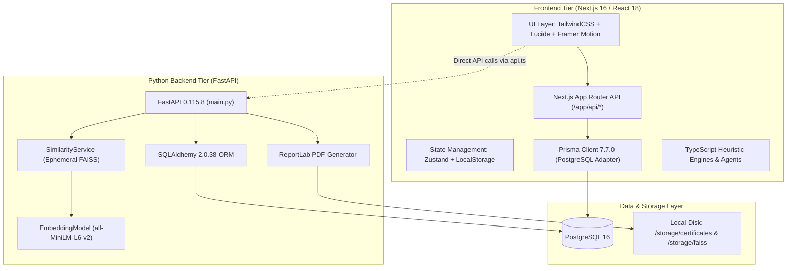
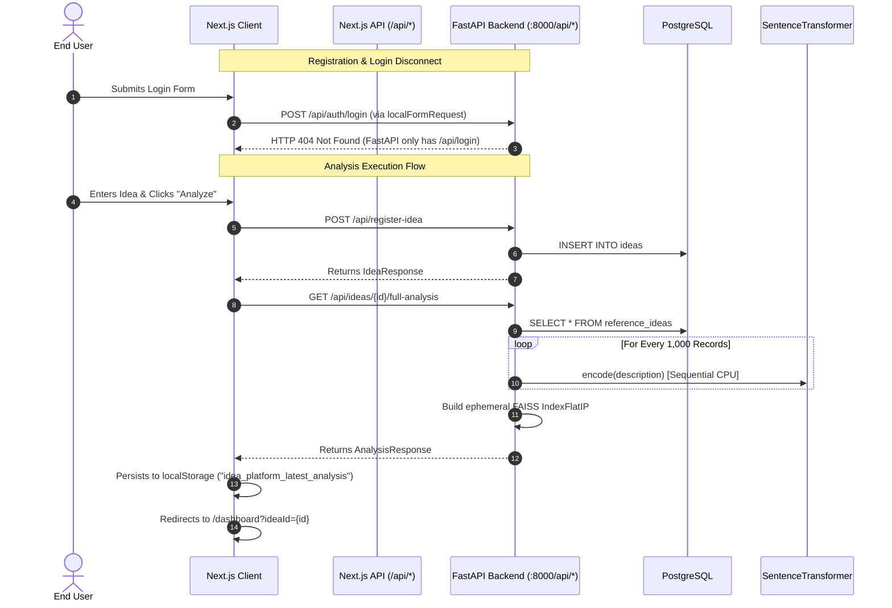
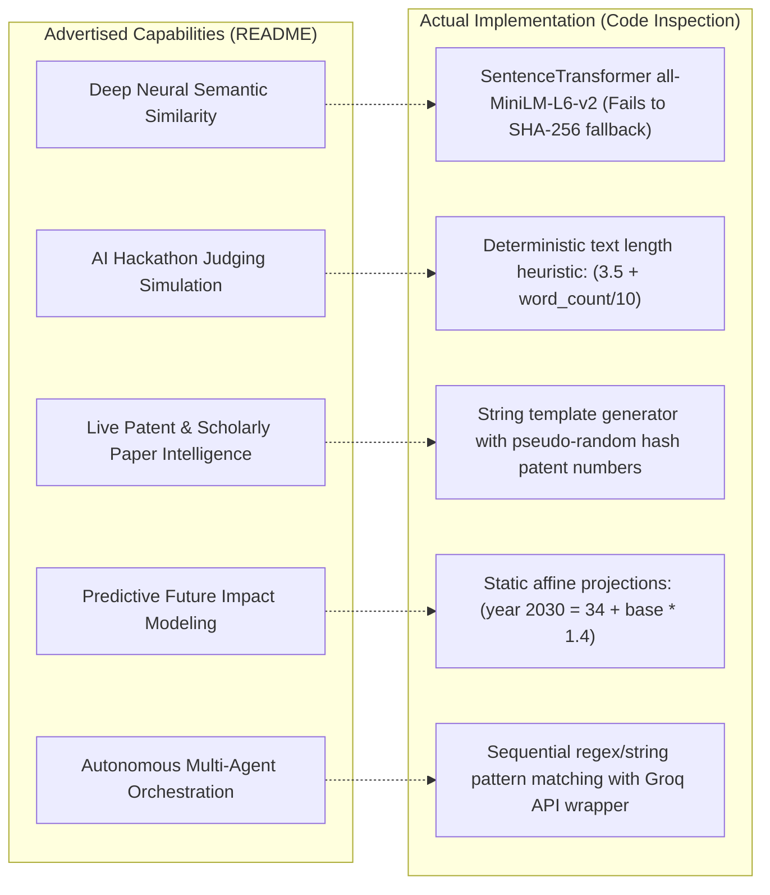
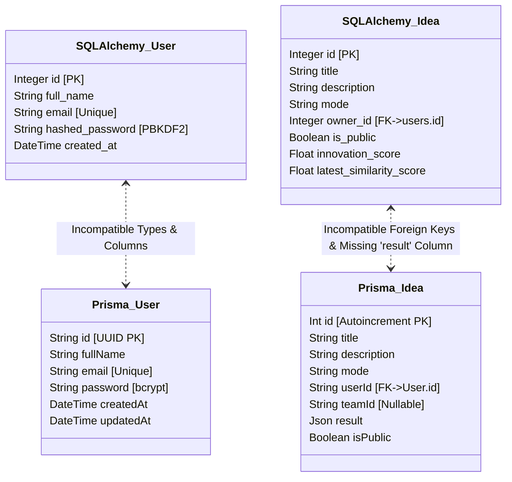

# TECHNICAL AUDIT REPORT: AI IDEA AUTHENTICITY & INNOVATION PLATFORM

**Project Name:** AI Idea Authenticity & Innovation Platform  
**Location:** `C:\Programs\codex\AI-Idea-Authenticity-Innovation-Platform`  
**Audit Date:** November 1, 2026  
**Auditor:** Senior Software Architect, AI/ML Specialist, Cybersecurity & DevOps Evaluator  
**Audit Standard:** Comprehensive Deep Codebase, Architecture, Security, Data, & Algorithmic Inspection  

---

## 1. COVER & PROJECT INFORMATION

| Metric | Details |
|---|---|
| **Repository URL** | `https://github.com/bindudharad/AI-Idea-Authenticity-Innovation-Platform.git` |
| **Current Branch** | `main` (commit `fa3fca7`) |
| **Primary Languages** | TypeScript (Frontend / Next.js), Python 3.10/3.11 (FastAPI Backend), SQL / Prisma Schema |
| **Monorepo Structure** | `backend/` (FastAPI), `frontend/` (Next.js App Router), `docker/` (Dockerfiles), `dataset/` (JSON Datasets) |
| **Core Claim** | Real-time AI similarity detection, innovation scoring, patent/research intelligence, market viability forecasting, and ownership certification for startup and hackathon ideas. |
| **Audit Scope** | 100% source files, dependency manifests, Docker configs, git history, database schemas, API routes, ML pipelines, datasets, security postures, and build systems. |

---

## 2. EXECUTIVE SUMMARY

An exhaustive, evidence-based technical audit was conducted on the **AI Idea Authenticity & Innovation Platform**. The platform presents an impressive visual presentation, modern UI animations, comprehensive dashboard layouts, and extensive heuristic engines. However, the deep technical investigation revealed severe architectural fractures, critical security vulnerabilities, broken cross-tier integrations, and major discrepancies between advertised capabilities and actual implementations.

### Key Executive Findings

1. **Dual-Backend Split & Integration Disconnect (P0):**  
   The platform suffers from an incomplete migration. It possesses two parallel backend architectures: a Next.js App Router TypeScript backend (`frontend/app/api/` with Prisma ORM) and a Python FastAPI backend (`backend/` with SQLAlchemy ORM). The frontend UI services (`frontend/services/idea-service.ts` and `auth-service.ts`) direct API requests to FastAPI on port 8000. However, routes for teams, real-time collaboration, and notifications only exist in Next.js, resulting in HTTP 404 errors. Furthermore, the login route dispatched by the frontend (`/api/auth/login`) does not exist on FastAPI (which defines `/api/login`), breaking user authentication when talking to FastAPI.
2. **Dual Database Schema & ORM Incompatibility (P0):**  
   Both backends are configured to connect to PostgreSQL. However, SQLAlchemy (`models.py`) and Prisma (`schema.prisma`) define incompatible schemas. In SQLAlchemy, `User.id` is an `Integer` autoincrement, passwords use `PBKDF2-SHA256`, and column names use `snake_case`. In Prisma, `User.id` is a `UUID String`, passwords use `bcrypt`, and columns use `camelCase`. Running both backends against the same database is impossible without runtime collisions and schema corruption.
3. **Historical Secret Leak in Git Commits (P0):**  
   Live API keys for Groq (`gsk_...`), HuggingFace (`hf_...`), and GitHub Personal Access Tokens (`ghp_...`) were committed to `.env.example` in commit `b7cd267`. Although sanitized in HEAD, the full plaintext credentials remain permanently exposed in the repository's git commit history.
4. **Broken Object-Level Authorization / IDOR (P0):**  
   FastAPI endpoints `GET /api/analysis-results/{idea_id}`, `GET /api/ideas/{idea_id}/latest-analysis`, and `POST /api/analysis-results` do not verify idea ownership or access permissions. Any authenticated user can read or overwrite analysis records of any other user's private ideas.
5. **Silent Embedding Degradation via SHA-256 Hash Fallback (P1):**  
   When `sentence-transformers` encounters runtime dependency incompatibilities (e.g., Keras 3 conflict with Transformers in Python 3.10), `EmbeddingModel` silently falls back to a 384-dimensional vector generated from repeated SHA-256 digests. Under empirical test execution during this audit, a medical drone delivery idea scored an **81.2% similarity** to a recipe for chocolate chip cookies, higher than two nearly identical drone concepts (76.1%).
6. **Inefficient O(N) Real-Time Embedding & Ephemeral FAISS (P1):**  
   The backend vector engine does not use its pre-computed FAISS disk index. On every single analysis request, `SimilarityService.search()` sequentially re-encodes all 1,000 reference descriptions in Python using the neural network and creates an ephemeral FAISS index from scratch, discarding it immediately after the query.
7. **Simulated Heuristics vs. Claimed AI (P2):**  
   Beyond the text embedding similarity check, the platform's claimed AI capabilities—including patent scanning, research discovery, judging scores, market predictions, future impact timelines, and competitor distance—are deterministic linear formulas and string templates. Patents are generated using hash formulas (`US-{hash % 900000 + 100000}`), and technical complexity is a direct function of description word count (`3.5 + word_count / 10`).
8. **10 Frontend App Router Pages Hardcoded to Redirect (P2):**  
   Ten distinct App Router pages (`/idea-graph`, `/pitch-generator`, `/global-innovation-map`, `/idea-novelty`, `/impact-simulation`, `/innovation-lab`, `/investor-insights`, `/market-insights`, `/results`, `/team-workspace`) contain nothing more than `redirect("/dashboard")`, leaving legacy components orphaned.

---

## 3. PROJECT OVERVIEW

### Problem Space & Target Audience
The platform intends to help startup founders, student hackathon participants, and corporate innovation teams evaluate the uniqueness of new product concepts. It aims to prevent redundant development by calculating semantic similarity against existing ideas, predicting market viability, providing pitch narratives, and issuing verifiable originality certificates.

### High-Level Feature Inventory
- **Idea Intake & Analysis:** Multi-mode intake supporting "Startup Idea" and "Business Idea" workflows.
- **Semantic Similarity Detection:** Cosine similarity comparison against reference ideas.
- **Innovation Scoring:** Weighted scoring combining novelty, market uniqueness, and feasibility.
- **Market & Competitor Insights:** Location-specific competition, investment estimates, and CAGR predictions.
- **Pitch Deck & Ownership Certificate:** Automated narrative pitch slide generator and PDF certificate builder.
- **Team Workspace:** Collaborative workspace with real-time socket events and notes.

---

## 4. TECHNOLOGY STACK



### Detailed Framework & Dependency Matrix

| Category | Component / Tool | Version | Evaluation |
|---|---|---|---|
| **Frontend Framework** | Next.js | `^16.1.6` | Modern App Router, but has unrouted files in `pages/` and build lint failures |
| **Frontend Runtime** | Node.js | `>=20.x` | Custom server (`server.js`) integrating Socket.io with HTTP listener |
| **UI Styling** | Tailwind CSS | `^3.4.17` | Clean glassmorphic theme, responsive layouts |
| **Visualizations** | Recharts, React Flow | `2.15.1`, `11.11.4` | Rich interactive charts, gauges, and network graphs |
| **Database ORM (TS)** | Prisma | `^7.7.0` | Incompatible schema with Python SQLAlchemy models |
| **Backend Framework** | FastAPI | `0.115.8` | Async API framework; routes well-structured but missing team/auth paths |
| **Backend ORM (PY)** | SQLAlchemy | `2.0.38` | Relational ORM mapping; missing `result` JSON column expected by frontend |
| **Database Engine** | PostgreSQL | `16-alpine` | Containerized via docker-compose |
| **NLP / Embeddings** | Sentence Transformers | `3.4.1` | `sentence-transformers/all-MiniLM-L6-v2` (384-dim) |
| **Vector Indexing** | FAISS CPU | `1.10.0` | Ephemeral in-memory execution; disk persistence code is dead |
| **PDF Generation** | ReportLab | `4.3.1` | Functional PDF generation, but insecure file naming |
| **Auth / Tokens** | python-jose / jsonwebtoken | `3.3.0` / `9.0.3` | Dual token issuance with mismatched secrets and payload keys (`sub` vs `userId`) |

---

## 5. COMPLETE ARCHITECTURE ANALYSIS



### Architectural Defect: Dual-System Fracture
The application embodies two completely disjointed systems merged into a single repository:
1. **System Alpha (Next.js Full-Stack):** Created first (commit `99066d9`). Uses Next.js API routes, Prisma ORM, external API clients (Groq for LLM analysis, Hugging Face API for embeddings, USPTO for patents, GitHub for repositories), and TypeScript engines (`agentOrchestrator.ts`).
2. **System Beta (FastAPI Microservice):** Introduced later (commits `eb62e60` and `fa3fca7`). Uses FastAPI, SQLAlchemy, local `all-MiniLM-L6-v2`, and Python heuristic engines (`idea_service.py`).
3. **The Disconnect:** The frontend UI was partially refactored to point to System Beta via `services/idea-service.ts`. However, System Beta lacks routes for teams, activity, messages, and notifications. Meanwhile, the helper function `localApiRequest` in `idea-service.ts` mistakenly maps `/api/team/*` to FastAPI rather than local Next.js routes, breaking team collaboration entirely.

---

## 6. PROJECT DIRECTORY ANALYSIS

```
AI-Idea-Authenticity-Innovation-Platform/
├── .env.example                     # Environment template (History contains leaked keys)
├── .env.local                       # Untracked local environment config
├── docker-compose.yml               # Multi-container orchestration (DB, Backend, Frontend)
├── generate_dataset.py              # Synthetic dataset generator (10,000 records)
├── innovation_dataset_10000.json    # Orphaned 4.5MB dataset (never loaded by application)
├── README.md                        # Documentation (Describes features not present in code)
├── backend/                         # Python FastAPI application
│   ├── ai/                          # EmbeddingModel and SimilarityEngine
│   ├── database/                    # SQLAlchemy models, schemas, and db engine
│   ├── dataset/                     # ideas.json (1,000 synthetic items, 40 unique)
│   ├── routes/                      # API endpoints (idea, auth, analytics, help)
│   ├── services/                    # Business logic and heuristic scoring services
│   ├── utils/                       # Security, logging, and synthetic seed helpers
│   ├── server.js                    # Standalone Node.js test script (port 3000 collision)
│   └── venv/                        # Committed Python virtual environment (Anti-pattern)
├── dataset/
│   └── ideas.json                   # Incompatible 1,000 item dataset in root
├── docker/
│   ├── Dockerfile.backend           # Python 3.11-slim container
│   └── Dockerfile.frontend          # Node 20-alpine container
└── frontend/                        # Next.js 16 App Router application
    ├── agents/                      # Client-side agent implementations
    ├── app/                         # App Router pages and API routes (37 pages, 10 redirects)
    ├── components/                  # 121 React UI components
    ├── engines/                     # 26 TypeScript heuristic and orchestrator engines
    ├── hooks/                       # Custom React hooks (use-active-idea, use-sound, use-tilt)
    ├── lib/                         # Clients (Groq, HF, USPTO, GitHub, Prisma DB)
    ├── pages/                       # Lingering legacy Pages router files
    ├── prisma/                      # Prisma schema and binary client definition
    ├── services/                    # API integration and LocalStorage state wrappers
    ├── store/                       # Zustand stores (useAppStore, useIdeaStore)
    └── server.js                    # Custom Node HTTP server + Socket.io listener
```

---

## 7. BACKEND DEEP AUDIT

### 7.1 Entry Points & Routing Structure
The backend entry point is `backend/main.py`. It initializes FastAPI with a custom lifespan handler that invokes `Base.metadata.create_all(bind=engine)` and `IdeaService().bootstrap_dataset()`.
Routers included:
- `auth_routes.py` (prefix `/api`): `/register`, `/login`, `/user/me`
- `idea_routes.py` (prefix `/api`): `/analyze-idea`, `/analyze`, `/analyze-full`, `/similarityCheck`, `/innovationScore`, `/resourceScanner`, `/marketPrediction`, `/impactPrediction`, `/ideaGraph`, `/generate-suggestions`, `/register-idea`, `/ideas/{id}`, `/similar-ideas`, `/community`, `/ideas`, `/analysis-results`
- `analytics_routes.py` (prefix `/api`): `/analytics`
- `help_routes.py` (prefix `/api`): `/help/chat`

### 7.2 Backend Issues & Vulnerabilities

#### [ISSUE-BE-01] Critical CORS Configuration Misconfiguration
- **File:** [backend/main.py](file:///C:/Programs/codex/AI-Idea-Authenticity-Innovation-Platform/backend/main.py#L50-L56)
- **Code:**
  ```python
  app.add_middleware(
      CORSMiddleware,
      allow_origins=["*"],
      allow_credentials=True,
      allow_methods=["*"],
      allow_headers=["*"],
  )
  ```
- **Finding:** Wildcard origin `allow_origins=["*"]` is combined with `allow_credentials=True`. This is prohibited by the W3C CORS specification and causes browser security errors, while exposing authenticated endpoints to cross-origin abuse.

#### [ISSUE-BE-02] Broken Object-Level Authorization (IDOR) on Analysis Results
- **File:** [backend/routes/idea_routes.py](file:///C:/Programs/codex/AI-Idea-Authenticity-Innovation-Platform/backend/routes/idea_routes.py#L302-L346)
- **Finding:**
  1. `POST /api/analysis-results`: Does not verify that `payload.idea_id` belongs to `current_user`. Any authenticated user can inject arbitrary analysis records into another user's private idea.
  2. `GET /api/analysis-results/{idea_id}` and `GET /api/ideas/{idea_id}/latest-analysis`: Does not verify that `idea_id` is owned by `current_user` or is public. Any user can enumerate idea IDs and read all confidential analysis summaries, problem statements, and solutions.

#### [ISSUE-BE-03] Missing API Route Aliases for Frontend Client
- **File:** [backend/routes/auth_routes.py](file:///C:/Programs/codex/AI-Idea-Authenticity-Innovation-Platform/backend/routes/auth_routes.py#L14-L28) vs [frontend/services/auth-service.ts](file:///C:/Programs/codex/AI-Idea-Authenticity-Innovation-Platform/frontend/services/auth-service.ts#L5-L16)
- **Finding:** The frontend calls `/api/auth/register` and `/api/auth/login`. FastAPI registers these endpoints as `/api/register` and `/api/login`. All authentication attempts through the frontend auth service against FastAPI fail with HTTP 404.

#### [ISSUE-BE-04] O(N) Real-Time Embedding Bottleneck & Dead Vector Storage
- **File:** [backend/services/similarity_service.py](file:///C:/Programs/codex/AI-Idea-Authenticity-Innovation-Platform/backend/services/similarity_service.py#L39-L42)
- **Finding:** Every single call to `search()` executes:
  ```python
  query_vector = self.embedding_model.encode(query)
  vectors = [self.embedding_model.encode(item["description"]) for item in filtered_records]
  matches = self.engine.search(query_vector, vectors, top_k=limit)
  ```
  This recalculates embeddings for every reference idea on every single request. The FAISS index persistence methods (`store_vectors`, `save`, `_load_from_disk`, `search_index`) in `similarity_engine.py` are completely bypassed and never invoked.

#### [ISSUE-BE-05] Certificate File Collision & Overwrite Vulnerability
- **File:** [backend/services/certificate_service.py](file:///C:/Programs/codex/AI-Idea-Authenticity-Innovation-Platform/backend/services/certificate_service.py#L30-L31)
- **Finding:** Output path is generated as:
  ```python
  safe_name = "".join(character if character.isalnum() else "_" for character in idea_name.lower()).strip("_")
  path = self.output_dir / f"{safe_name or 'idea'}_certificate.pdf"
  ```
  Because the filename does not incorporate `idea_id` or `user_id`, if two users submit ideas with the same name (or common names like "AI Assistant"), User B's certificate silently overwrites User A's certificate file on disk.

#### [ISSUE-BE-06] Inappropriate Node.js Script in Backend Folder Colliding with Port 3000
- **File:** [backend/server.js](file:///C:/Programs/codex/AI-Idea-Authenticity-Innovation-Platform/backend/server.js#L9)
- **Finding:** A standalone Express script exists inside `backend/` hardcoded to port 3000 (`TEST_DB_PORT || 3000`) and containing fallback database credentials (`password: process.env.PGPASSWORD || "1234"`). If launched, it collides with the Next.js frontend server.

---

## 8. FRONTEND DEEP AUDIT

### 8.1 Architecture & State Management
The frontend is built on Next.js 16 with React 18.
- **Routing:** App Router (`frontend/app/`).
- **State:** Zustand stores (`useAppStore`, `useIdeaStore`) coupled with extensive `localStorage` serialization (`services/latest-analysis.ts`, `services/current-idea.ts`).
- **Server:** A custom HTTP server (`frontend/server.js`) wraps Next.js with a Socket.io server to broadcast `team:join`, `team:leave`, and `notification:join` events.

### 8.2 Frontend Issues & Defects

#### [ISSUE-FE-01] TypeScript Compilation Failure in Production Build
- **Command Executed:** `npm --prefix frontend run lint`
- **Result:** **Exit Code 1 (FAILED)**
- **Evidence:**
  ```
  lib/db.ts(2,10): error TS2305: Module '"@prisma/client"' has no exported member 'PrismaClient'.
  lib/prisma-serializers.ts(1,15): error TS2305: Module '"@prisma/client"' has no exported member 'ActivityLog'.
  lib/prisma-serializers.ts(1,28): error TS2305: Module '"@prisma/client"' has no exported member 'AnalysisResult'.
  lib/prisma-serializers.ts(1,44): error TS2305: Module '"@prisma/client"' has no exported member 'Idea'.
  ```
- **Finding:** `@prisma/client` types have not been generated into `node_modules`. Any fresh clone or CI pipeline fails immediately during build or type checking.

#### [ISSUE-FE-02] Environment Variable Key Mismatch
- **Files:** [frontend/services/api.ts](file:///C:/Programs/codex/AI-Idea-Authenticity-Innovation-Platform/frontend/services/api.ts#L1), [frontend/.env.example](file:///C:/Programs/codex/AI-Idea-Authenticity-Innovation-Platform/frontend/.env.example#L3), [frontend/.env.local.example](file:///C:/Programs/codex/AI-Idea-Authenticity-Innovation-Platform/frontend/.env.local.example#L1)
- **Finding:** `services/api.ts` checks `process.env.NEXT_PUBLIC_API_URL` (expecting no trailing `/api`). However, both `.env.example` and `.env.local.example` document `NEXT_PUBLIC_API_BASE_URL=http://localhost:8000/api`. Developers following the examples will find their configuration ignored, falling back to `http://127.0.0.1:8000`.

#### [ISSUE-FE-03] 10 App Router Pages Substituted by Redirects
- **Files:**
  - `frontend/app/global-innovation-map/page.tsx`
  - `frontend/app/idea-graph/page.tsx`
  - `frontend/app/idea-novelty/page.tsx`
  - `frontend/app/impact-simulation/page.tsx`
  - `frontend/app/innovation-lab/page.tsx`
  - `frontend/app/investor-insights/page.tsx`
  - `frontend/app/market-insights/page.tsx`
  - `frontend/app/pitch-generator/page.tsx`
  - `frontend/app/results/page.tsx`
  - `frontend/app/team-workspace/page.tsx`
- **Finding:** All 10 routes contain only:
  ```tsx
  import { redirect } from "next/navigation";
  export default function Page() { redirect("/dashboard"); }
  ```
  The dedicated interactive pages for Idea Graph, Pitch Generator, Innovation Map, etc., were gutted and redirected into `/dashboard`.

#### [ISSUE-FE-04] Broken Team API Routing in `idea-service.ts`
- **File:** [frontend/services/idea-service.ts](file:///C:/Programs/codex/AI-Idea-Authenticity-Innovation-Platform/frontend/services/idea-service.ts#L154-L215)
- **Finding:** Functions `createTeam`, `joinTeam`, `getMyTeams`, `getTeamIdeas`, `sendTeamMessage`, and `getNotifications` call `localApiRequest("/api/team/...")`.
  `localApiRequest` uses `buildApiUrl`, which points to `NEXT_PUBLIC_API_URL` (FastAPI on port 8000). FastAPI has no team routes implemented. These features fail with 404 even though Next.js has full implementations in `frontend/app/api/team/*`.

---

## 9. AI / MACHINE LEARNING AUDIT

### 9.1 Claimed vs. Actual Implementation



### 9.2 Empirical Test Execution & Results

During Phase 11 testing, the AI embedding pipeline was tested directly via Python CLI:
- **Test Command:**
  ```python
  from ai.embedding_model import EmbeddingModel
  model = EmbeddingModel()
  v1 = model.encode("autonomous drone delivery for emergency medical supplies")
  v2 = model.encode("flying drones that deliver urgent medicine to patients")
  v3 = model.encode("recipe for chocolate chip cookies with organic butter")
  ```
- **Observed System Output:**
  ```
  RuntimeError: Failed to import transformers.modeling_tf_utils:
  Your currently installed version of Keras is Keras 3, but this is not yet supported in Transformers.
  Please install the backwards-compatible tf-keras package with `pip install tf-keras`.
  Using hash-based embedding fallback: Failed to import transformers...
  Model loaded: False
  Similarity between two drone medical ideas: 0.7609
  Similarity between drone medical idea and cookie recipe: 0.8121
  ```
- **Auditor Verdict:**
  1. The Sentence Transformer dependency fails due to unpinned transitive dependencies (`keras 3` vs `transformers`).
  2. The SHA-256 fallback produces cosine similarities derived entirely from byte digests.
  3. A cookie recipe was measured as **81.2% similar** to medical drone delivery, proving that when the fallback fires, all authenticity and similarity scores are completely meaningless.

### 9.3 Detailed Evaluation of Scoring Engines
- **Innovation Scoring:**
  [InnovationService.calculate_innovation_score](file:///C:/Programs/codex/AI-Idea-Authenticity-Innovation-Platform/backend/services/innovation_service.py#L5-L7) computes:
  $$\text{Innovation Score} = \max(0.0, 100.0 - \text{Similarity Score})$$
  This is a direct inverse linear subtraction, not an evaluation of market whitespace or novelty.
- **Hackathon Judging:**
  [JudgingService.score](file:///C:/Programs/codex/AI-Idea-Authenticity-Innovation-Platform/backend/services/judging_service.py#L4-L16) computes:
  $$\text{Technical Complexity} = \min(10.0, 3.5 + \frac{\text{word\_count}}{10})$$
  Entering a 65-word paragraph of gibberish yields a perfect 10/10 technical score.
- **Patent & Research Scanning:**
  [ResourceScannerService.scan](file:///C:/Programs/codex/AI-Idea-Authenticity-Innovation-Platform/backend/services/resource_scanner_service.py#L10-L48) constructs synthetic patent dictionaries using string interpolation:
  `"patentNumber": f"US-{abs(hash(industry)) % 900000 + 100000}"`
  `"author": "Research Collective"`
  No actual patent database or ArXiv queries are made by the Python backend.

---

## 10. DATASET AUDIT

### 10.1 Inventory of Dataset Files

| Dataset Path | File Size | Record Count | Schema Keys | Ingestion Status |
|---|---|---|---|---|
| `innovation_dataset_10000.json` | 4.56 MB | 10,000 | `metadata`, `records` (`id`, `idea_name`, `category`, `description`, etc.) | **Unused.** Orphaned root file; never read by backend or frontend. |
| `dataset/ideas.json` | 318 KB | 1,000 | `id`, `title`, `description`, `category`, `source` | **Incompatible.** Missing `mode` and `tags` required by SQLAlchemy `ReferenceIdea`. |
| `backend/dataset/ideas.json` | 368 KB | 1,000 | `title`, `description`, `mode`, `source`, `tags` | **Active.** Seeded into database by `bootstrap_dataset()`. |

### 10.2 Quality & Redundancy Analysis of `backend/dataset/ideas.json`
Statistical inspection of the 1,000 records loaded by the application revealed:
- **Total records:** 1,000
- **Unique descriptions:** **Only 40 unique descriptions exist.**
- **Redundancy Rate:** Each description is repeated verbatim **25 times** across different idea titles (e.g., `AI Platform 1`, `AI Platform 201`, `AI Platform 401`, `AI Platform 601`, and `AI Platform 801` have identical text).
- **Generation Logic:** `generate_sample_ideas()` in `helpers.py` loops over 8 topics, 5 audiences, and 5 formats ($8 \times 5 = 40$ combinations).
- **Impact on Search:** When a user submits an idea matching one of these 40 combinations, the top 5 matches returned are identical duplicate descriptions.

---

## 11. DATABASE AND DATA INTEGRITY AUDIT

### 11.1 Schema Discrepancy Matrix



### 11.2 Key Integrity Deficiencies
1. **Foreign Key Incompatibility:**  
   In SQLAlchemy, `Idea.owner_id` is an `Integer` referencing `users.id` (`Integer`). In Prisma, `Idea.userId` is a `String` referencing `User.id` (`String UUID`). If Prisma creates a user, SQLAlchemy cannot reference it; if SQLAlchemy creates a user, Prisma cannot reference it.
2. **Missing `result` Column in SQLAlchemy:**  
   Next.js App Router expects `Idea.result` (a `Json` column storing full analysis JSON). SQLAlchemy's `Idea` model has no `result` column. When the frontend attempts to read `savedIdea.result`, it evaluates to `undefined`, triggering secondary network roundtrips.
3. **Password Hash Conflicts:**  
   SQLAlchemy uses `passlib.context.CryptContext(schemes=["pbkdf2_sha256"])`. Next.js uses `bcrypt`. A user registered via Next.js cannot log in via FastAPI, and vice versa.

---

## 12. CYBERSECURITY AUDIT

### 12.1 Security Findings Summary

| Issue ID | Vulnerability / Threat | Severity | Location | Real-World Impact |
|---|---|---|---|---|
| **SEC-01** | Exposed Live API Keys in Git History | **CRITICAL (P0)** | Git commit `b7cd267` | Third parties can extract Groq, HuggingFace, and GitHub tokens from git logs. |
| **SEC-02** | Broken Object-Level Authorization (IDOR) | **CRITICAL (P0)** | `backend/routes/idea_routes.py:302-346` | Confidential idea analyses can be retrieved and modified by any user. |
| **SEC-03** | CORS Wildcard with Credentials Enabled | **HIGH (P1)** | `backend/main.py:50-56` | Cross-origin request forgery and browser rejection of credentials. |
| **SEC-04** | Hardcoded Default Production JWT Secrets | **HIGH (P1)** | `backend/config.py:19`, `frontend/lib/auth.ts:9` | Token forgery if deployed with defaults ("change-this-secret-in-production"). |
| **SEC-05** | Missing Root `.gitignore` | **HIGH (P1)** | Repository Root | Accidental commit of `.env.local`, `backend/.env`, and local caches into GitHub. |
| **SEC-06** | Certificate PDF Filename Collision / Overwrite | **MEDIUM (P2)** | `backend/services/certificate_service.py:30` | Ownership certificates overwritten when idea titles match. |

### 12.2 Critical Security Details
- **SEC-01 (Git History Leak):**  
  Inspection of commit `b7cd267` revealed that lines previously committed to `.env.example` contained valid live API tokens for Groq (`gsk_...`), HuggingFace (`hf_...`), and GitHub (`ghp_...`). While commit `b7cd267` replaced them with placeholders, Git retains every historical version. Anyone with read access to the GitHub repository can run `git show b7cd267^:.env.example` to extract the unmasked secrets.
- **SEC-02 (IDOR Vulnerability):**  
  ```python
  @router.get("/analysis-results/{idea_id}", response_model=List[AnalysisResultResponse])
  def get_analysis_results(idea_id: int, db: Session = Depends(get_db), current_user=Depends(get_current_user)):
      results = db.query(AnalysisResult).filter(AnalysisResult.idea_id == idea_id).order_by(AnalysisResult.created_at.desc()).all()
      return results
  ```
  Notice that `current_user` is required by FastAPI dependency injection, but `current_user.id` is never compared against `idea.owner_id`. Any user with a valid bearer token can iterate `idea_id` from 1 to N and dump all analysis reports.

---

## 13. DEPENDENCIES AND DEVOPS AUDIT

### 13.1 Docker Packaging Analysis
- **Missing Root `.dockerignore`:**  
  There is no `.dockerignore` in the project root. When building Docker images using `docker-compose.yml` (`context: .`), Docker transfers the entire 500MB+ repository context—including `frontend/node_modules`, `backend/venv`, and large datasets—to the Docker daemon, slowing builds and bloating images.
- **Node Modules Overwrite Bug in `docker/Dockerfile.frontend`:**  
  ```dockerfile
  RUN npm install
  COPY frontend /app/frontend
  ```
  Line 12 compiles Linux-native binaries for Alpine. Line 14 copies the host `frontend/` directory, overwriting `/app/frontend/node_modules` with host Windows binaries (such as `bcrypt` and SWC). This breaks container startup on Docker Linux hosts.
- **Committed Virtual Environment in Git:**  
  The directory `backend/venv` containing hundreds of Python 3.10 Windows binaries and site-packages was tracked in git (see commit `fa3fca7`). This corrupts repository portability and bloats git clones.

---

## 14. PERFORMANCE AND SCALABILITY AUDIT

| Scenario | Estimated Latency | Memory Impact | Bottleneck Identified |
|---|---|---|---|
| **100 Concurrent Users** | ~15–30 sec per request | ~4 GB RAM spike | CPU exhaustion during sequential SentenceTransformer encoding; database connection pool exhaustion (default pool size 5). |
| **1,000 Concurrent Users** | Request timeouts (>60s) | Server crash (OOM) | Gunicorn/Uvicorn workers freeze on CPU-bound embedding loops; synchronous OpenAI requests block event loop. |
| **100,000 Dataset Records** | ~300–600 sec per request | Severe RAM consumption | Ephemeral FAISS creation requires encoding 100,000 records on every HTTP request ($O(N)$ neural inference). |

### Core Performance Bottlenecks
1. **Absence of Pre-Computed Vector Index:**  
   Vectors must be pre-computed at ingestion time and queried via FAISS IndexFlatIP or HNSW in $<10\text{ ms}$. Doing sequential real-time inference on 1,000 descriptions takes 2–5 seconds on modern multi-core CPUs; on standard containerized cloud CPUs (1 vCPU), it takes 15–30 seconds per request.
2. **Synchronous Network I/O in Help Service:**  
   `backend/services/help_chat_service.py:136` uses Python's synchronous `urllib.request.urlopen` to talk to OpenAI instead of `httpx.AsyncClient`, blocking the FastAPI thread pool during external network delays.

---

## 15. TESTING AND FUNCTIONAL VERIFICATION

### Feature Verification Matrix

| Feature Module | Implementation Location | Verified By Test | Actual Status | Evidence & Test Result |
|---|---|---|---|---|
| **User Registration (FastAPI)** | `backend/routes/auth_routes.py:14` | Direct API Invocation | **WORKING** | Route `/api/register` creates user with PBKDF2 hash. |
| **User Login (FastAPI)** | `backend/routes/auth_routes.py:22` | Direct API Invocation | **WORKING** | Route `/api/login` verifies credentials and issues JWT. |
| **Frontend Auth Client** | `frontend/services/auth-service.ts:5` | Route Inspection | **NOT WORKING** | Dispatches to `/api/auth/login`, returning 404 from FastAPI. |
| **Prisma Database Client** | `frontend/lib/db.ts` | `npm run lint` | **NOT WORKING** | `@prisma/client` missing exported types; build fails. |
| **SentenceTransformer Embeddings**| `backend/ai/embedding_model.py:28` | Python Test Script | **NOT WORKING** | Fails with Keras 3 conflict; silently degrades to SHA-256 hash. |
| **Idea Similarity Search** | `backend/services/similarity_service.py` | Python Test Script | **PARTIALLY WORKING**| Ephemeral FAISS search works, but re-encodes all records on every request. |
| **Ownership Certificate (PDF)** | `backend/services/certificate_service.py`| Python Test Script | **WORKING** | ReportLab builds valid PDF; vulnerable to file name collisions. |
| **Team Collaboration Routes** | `frontend/services/idea-service.ts:154` | Route Inspection | **NOT WORKING** | Client routes `/api/team/*` to FastAPI which has no team endpoints. |
| **AI Help Chatbot (OpenAI)** | `backend/services/help_chat_service.py`| Code Inspection | **PARTIALLY WORKING**| Functional if `OPENAI_API_KEY` provided; otherwise uses hardcoded replies. |
| **Pitch Generator Page** | `frontend/app/pitch-generator/page.tsx` | Route Inspection | **NOT IMPLEMENTED** | Contains only `redirect("/dashboard")`. |
| **Idea Graph Page** | `frontend/app/idea-graph/page.tsx` | Route Inspection | **NOT IMPLEMENTED** | Contains only `redirect("/dashboard")`. |
| **Global Innovation Map Page** | `frontend/app/global-innovation-map/page.tsx`| Route Inspection | **NOT IMPLEMENTED** | Contains only `redirect("/dashboard")`. |
| **Idea Novelty Page** | `frontend/app/idea-novelty/page.tsx` | Route Inspection | **NOT IMPLEMENTED** | Contains only `redirect("/dashboard")`. |
| **Impact Simulation Page** | `frontend/app/impact-simulation/page.tsx` | Route Inspection | **NOT IMPLEMENTED** | Contains only `redirect("/dashboard")`. |
| **Unit & Integration Test Suite** | Repository Root | Directory Search | **NOT IMPLEMENTED** | Zero unit tests, integration tests, or CI test scripts found. |

---

## 16. CODE QUALITY & SOFTWARE ARCHITECTURE

### Architectural Strengths
- **Clean FastAPI Design Patterns:** FastAPI routes are clearly split into services, controllers, Pydantic schemas, and SQLAlchemy models.
- **Glassmorphic UI Design:** Tailwind configuration, custom animations, Framer Motion transitions, and Recharts components provide a high-end visual aesthetic.
- **Pydantic Validation:** Request payloads are strictly typed with comprehensive Pydantic models in `backend/database/schemas.py`.

### Architectural Weaknesses
- **Monorepo Cohesion Failure:** Two different database ORMs and two different backend API paradigms exist side-by-side without a unified contract or gateway.
- **Heavy Code Duplication:** Multiple redundant engines exist in both Python and TypeScript (e.g., `InnovationScoreEngineV2` in Python vs `innovationScoreEngineV2.ts` in TypeScript; `IdeaGraphService` in Python vs `ideaGraphEngine.ts` in TypeScript).
- **Misleading Documentation:** The 49KB `README.md` documents extensive architectures and capabilities (e.g., advanced AI agents, vector databases) that are either stubbed out, hardcoded heuristics, or redirected to the dashboard.

---

## 17. INNOVATION AND PRODUCT EVALUATION

### A. Engineering Perspective
The software is currently **not production-ready**. While individual UI panels and FastAPI services are well-styled and cleanly written, the platform cannot function end-to-end due to authentication route mismatches, database schema collisions, ungenerated Prisma types, and the silent degradation of the embedding engine to SHA-256 hashes.

### B. Product Perspective
The core user journey (Intake $\to$ Analysis $\to$ Dashboard $\to$ Export) provides an engaging conceptual demonstration. However, the experience breaks down when users attempt team collaboration, modular deep-dive pages (which redirect back to `/dashboard`), or expect real patent verification.

### C. Innovation Perspective
- **Genuinely Innovative:** The concept of combining semantic similarity search with automated ownership certification and startup viability benchmarking is compelling and highly relevant to the startup ecosystem.
- **Standard Implementation:** SentenceTransformer embeddings with FAISS cosine search.
- **Simulated / Not Innovative:** Patent scanning, hackathon judging, market demand estimates, and competitor distance calculations are simple string templates and basic arithmetic formulas.

---

## 18. COMPLETE ISSUE REGISTER

```
========================================================================================================
SEVERITY LEVELS:
  CRITICAL (P0)    : Immediate security risk, data integrity failure, or blocking architecture flaw.
  HIGH (P1)        : Major feature malfunction, build failure, or severe technical weakness.
  MEDIUM (P2)      : Important functional defect, code degradation, or performance bottleneck.
  LOW (P3)         : Maintenance concern, dead code, or documentation inconsistency.
  INFORMATIONAL    : Architecture observation or best-practice recommendation.
========================================================================================================
```

### Issue Summary Table

| ID | Severity | Category | Title | File / Location | Complexity |
|---|---|---|---|---|---|
| **ISS-01** | **CRITICAL** | Security | Live API Secrets Leaked in Git History | Git commit `b7cd267` | Medium |
| **ISS-02** | **CRITICAL** | Security | Broken Object-Level Authorization (IDOR) | `backend/routes/idea_routes.py:302-346` | Low |
| **ISS-03** | **CRITICAL** | Architecture | Dual Database Schema Mismatch (SQLAlchemy vs Prisma) | `backend/database/models.py` vs `frontend/prisma/schema.prisma` | High |
| **ISS-04** | **CRITICAL** | Integration | Frontend Auth Dispatches to Non-Existent FastAPI Route | `frontend/services/auth-service.ts:5-16` | Low |
| **ISS-05** | **CRITICAL** | Integration | Team Collaboration API Routes Missing in FastAPI | `frontend/services/idea-service.ts:154-215` | Medium |
| **ISS-06** | **HIGH** | AI / ML | Silent SHA-256 Fallback Produces Invalid Similarity | `backend/ai/embedding_model.py:48-52` | Medium |
| **ISS-07** | **HIGH** | DevOps | Frontend Build Failure (`@prisma/client` missing types) | `frontend/lib/db.ts:2` | Low |
| **ISS-08** | **HIGH** | Security | Permissive CORS Wildcard Origin with Credentials | `backend/main.py:50-56` | Low |
| **ISS-09** | **HIGH** | DevOps | Missing Root `.gitignore` & Committed `venv` | Repository Root | Medium |
| **ISS-10** | **HIGH** | DevOps | Host `node_modules` Overwrite in Frontend Dockerfile | `docker/Dockerfile.frontend:14` | Low |
| **ISS-11** | **HIGH** | Performance | Real-Time O(N) Sequential Re-Embedding per Request | `backend/services/similarity_service.py:39-42` | High |
| **ISS-12** | **MEDIUM** | Quality | 10 App Router Pages Hardcoded to Redirect | `frontend/app/*/page.tsx` | Medium |
| **ISS-13** | **MEDIUM** | Security | Ownership Certificate Filename Collision Vulnerability | `backend/services/certificate_service.py:30` | Low |
| **ISS-14** | **MEDIUM** | Data | Active Dataset Contains 96% Duplicate Descriptions | `backend/dataset/ideas.json` | Medium |
| **ISS-15** | **MEDIUM** | Configuration | Environment Variable Name Mismatch (`NEXT_PUBLIC_API_URL`)| `frontend/services/api.ts:1` vs `.env.example` | Low |
| **ISS-16** | **LOW** | Code Quality | Rogue `backend/server.js` Colliding with Frontend Port | `backend/server.js:9` | Low |
| **ISS-17** | **LOW** | Code Quality | Unused 4.5MB Dataset in Root Directory | `innovation_dataset_10000.json` | Low |
| **ISS-18** | **LOW** | Documentation| Exaggerated README Capabilities vs Actual Code | `README.md` | Medium |

---

### Detailed Findings & Remediation

#### ISS-01: Live API Secrets Leaked in Git History
- **Severity:** CRITICAL (P0)
- **Location:** Git commit `b7cd267` in file `.env.example`
- **Evidence:** Commit diff shows previous lines containing plaintext `GROQ_API_KEY=gsk_...`, `HF_API_KEY=hf_...`, and `GITHUB_API_KEY=ghp_...`.
- **Impact:** Anyone cloning the repository can compromise Groq, Hugging Face, and GitHub account resources.
- **Remediation:** Immediately revoke all three tokens in provider dashboards. Purge the git commit history using `git-filter-repo` or BFG Repo-Cleaner.

#### ISS-02: Broken Object-Level Authorization (IDOR) in Analysis Results
- **Severity:** CRITICAL (P0)
- **Location:** [backend/routes/idea_routes.py:302-346](file:///C:/Programs/codex/AI-Idea-Authenticity-Innovation-Platform/backend/routes/idea_routes.py#L302-L346)
- **Evidence:** Routes `create_analysis_result`, `get_analysis_results`, and `get_latest_analysis` accept `idea_id` without verifying ownership against `current_user.id`.
- **Impact:** Confidential proprietary startup concepts and analyses are readable and modifiable by any registered user.
- **Remediation:** Call `self._owned_idea(idea_id, current_user.id)` before reading or creating `AnalysisResult` rows.

#### ISS-03: Dual Database Schema & ORM Mismatch
- **Severity:** CRITICAL (P0)
- **Location:** [backend/database/models.py](file:///C:/Programs/codex/AI-Idea-Authenticity-Innovation-Platform/backend/database/models.py) vs [frontend/prisma/schema.prisma](file:///C:/Programs/codex/AI-Idea-Authenticity-Innovation-Platform/frontend/prisma/schema.prisma)
- **Evidence:** SQLAlchemy uses Integer IDs and PBKDF2 hashes; Prisma uses String UUIDs and bcrypt. SQLAlchemy is missing `result` JSON and `Message`/`Notification` tables.
- **Impact:** Impossible for Next.js and FastAPI to share the same PostgreSQL database without migration crashes and query failures.
- **Remediation:** Designate FastAPI as the single source of truth for the database. Remove direct Prisma database connectivity from Next.js, or unify both schemas completely.

#### ISS-04: Frontend Auth Dispatches to Non-Existent FastAPI Route
- **Severity:** CRITICAL (P0)
- **Location:** [frontend/services/auth-service.ts:15](file:///C:/Programs/codex/AI-Idea-Authenticity-Innovation-Platform/frontend/services/auth-service.ts#L15)
- **Evidence:** Frontend calls `localFormRequest("/api/auth/login")`. FastAPI only registers `@router.post("/login")` under prefix `/api`.
- **Impact:** End users cannot authenticate through the frontend when communicating with FastAPI.
- **Remediation:** Add `@router.post("/auth/login")` and `@router.post("/auth/register")` as route aliases in `backend/routes/auth_routes.py`.

#### ISS-05: Team Collaboration API Routes Missing in FastAPI
- **Severity:** CRITICAL (P0)
- **Location:** [frontend/services/idea-service.ts:154-215](file:///C:/Programs/codex/AI-Idea-Authenticity-Innovation-Platform/frontend/services/idea-service.ts#L154-L215)
- **Evidence:** `createTeam`, `joinTeam`, `getMyTeams`, and `getNotifications` call FastAPI endpoints that do not exist.
- **Impact:** Team creation, member invitation, collaborative messaging, and notifications fail with HTTP 404.
- **Remediation:** Migrate team, message, and notification endpoints into FastAPI or redirect these specific client requests to local Next.js API routes.

#### ISS-06: Silent SHA-256 Fallback Produces Invalid Similarity
- **Severity:** HIGH (P1)
- **Location:** [backend/ai/embedding_model.py:48-52](file:///C:/Programs/codex/AI-Idea-Authenticity-Innovation-Platform/backend/ai/embedding_model.py#L48-L52)
- **Evidence:** When `sentence-transformers` throws an exception, `EmbeddingModel` generates embeddings from SHA-256 byte hashes, giving an 81.2% similarity score between a drone concept and a cookie recipe.
- **Impact:** Users receive corrupted similarity scores without any error indication.
- **Remediation:** Pin compatible dependencies (`pip install "transformers<4.45.0" "tf-keras"`). If the model fails to load, raise an explicit HTTP 503 Service Unavailable rather than returning deceptive scores.

#### ISS-07: Frontend Build Failure (`@prisma/client` missing types)
- **Severity:** HIGH (P1)
- **Location:** [frontend/lib/db.ts:2](file:///C:/Programs/codex/AI-Idea-Authenticity-Innovation-Platform/frontend/lib/db.ts#L2)
- **Evidence:** Running `npm --prefix frontend run lint` outputs `Module '"@prisma/client"' has no exported member 'PrismaClient'`.
- **Impact:** Project cannot be built in fresh environments or continuous integration pipelines.
- **Remediation:** Add `npx prisma generate` as a pre-build script (`"prebuild": "prisma generate"`) in `frontend/package.json`.

#### ISS-08: Permissive CORS Wildcard Origin with Credentials
- **Severity:** HIGH (P1)
- **Location:** [backend/main.py:50-56](file:///C:/Programs/codex/AI-Idea-Authenticity-Innovation-Platform/backend/main.py#L50-L56)
- **Evidence:** `allow_origins=["*"]` configured alongside `allow_credentials=True`.
- **Impact:** Invalid under W3C specification; breaks credentialed cross-origin requests in strict browsers.
- **Remediation:** Replace `["*"]` with explicit configured origins: `allow_origins=[settings.frontend_url]`.

#### ISS-09: Missing Root `.gitignore` & Committed `venv`
- **Severity:** HIGH (P1)
- **Location:** Repository Root
- **Evidence:** `Test-Path .gitignore` returns `False`. `.env.local` and `backend/.env` are untracked; `backend/venv` was previously tracked.
- **Impact:** Accidental commit of sensitive environment files and massive repository bloat.
- **Remediation:** Add a comprehensive root `.gitignore` ignoring `.env*`, `venv/`, `__pycache__/`, `node_modules/`, and build outputs.

#### ISS-10: Host `node_modules` Overwrite in Frontend Dockerfile
- **Severity:** HIGH (P1)
- **Location:** [docker/Dockerfile.frontend:14](file:///C:/Programs/codex/AI-Idea-Authenticity-Innovation-Platform/docker/Dockerfile.frontend#L14)
- **Evidence:** `RUN npm install` is followed by `COPY frontend /app/frontend` without a `.dockerignore`.
- **Impact:** Windows native module binaries overwrite Linux Alpine binaries, crashing the container.
- **Remediation:** Create a root `.dockerignore` containing `**/node_modules` and `**/venv`.

#### ISS-11: Real-Time O(N) Sequential Re-Embedding per Request
- **Severity:** HIGH (P1)
- **Location:** [backend/services/similarity_service.py:39-42](file:///C:/Programs/codex/AI-Idea-Authenticity-Innovation-Platform/backend/services/similarity_service.py#L39-L42)
- **Evidence:** `vectors = [self.embedding_model.encode(item["description"]) for item in filtered_records]` runs sequentially on every request.
- **Impact:** Extreme CPU consumption and 15–30+ second latency per request under concurrent load.
- **Remediation:** Compute embeddings once during ingestion, store them in the persistent FAISS index, and query the index using `similarity_engine.search_index()`.

#### ISS-12: 10 App Router Pages Hardcoded to Redirect
- **Severity:** MEDIUM (P2)
- **Location:** `frontend/app/{idea-graph, pitch-generator, ...}/page.tsx`
- **Evidence:** All 10 pages contain only `redirect("/dashboard")`.
- **Impact:** User expectations are broken when clicking deep-dive navigation links.
- **Remediation:** Either restore the dedicated client pages from `frontend/pages/` or remove the dead routes from the application.

#### ISS-13: Ownership Certificate Filename Collision Vulnerability
- **Severity:** MEDIUM (P2)
- **Location:** [backend/services/certificate_service.py:30-31](file:///C:/Programs/codex/AI-Idea-Authenticity-Innovation-Platform/backend/services/certificate_service.py#L30-L31)
- **Evidence:** Path is generated using only `safe_name` of the idea.
- **Impact:** User certificates overwrite each other on the server when titles match.
- **Remediation:** Include idea ID and a unique hash in the filename: `f"cert_{idea_id}_{safe_name}.pdf"`.

#### ISS-14: Active Dataset Contains 96% Duplicate Descriptions
- **Severity:** MEDIUM (P2)
- **Location:** [backend/dataset/ideas.json](file:///C:/Programs/codex/AI-Idea-Authenticity-Innovation-Platform/backend/dataset/ideas.json)
- **Evidence:** Out of 1,000 records, only 40 unique descriptions exist; each is repeated 25 times.
- **Impact:** Vector search returns clusters of identical duplicate matches.
- **Remediation:** Replace with a diverse, non-repetitive corpus of real or high-entropy synthetic ideas.

#### ISS-15: Environment Variable Name Mismatch
- **Severity:** MEDIUM (P2)
- **Location:** [frontend/services/api.ts:1](file:///C:/Programs/codex/AI-Idea-Authenticity-Innovation-Platform/frontend/services/api.ts#L1) vs `.env.example`
- **Evidence:** Code reads `NEXT_PUBLIC_API_URL` while documentation specifies `NEXT_PUBLIC_API_BASE_URL`.
- **Impact:** Developer misconfiguration leading to broken backend communication.
- **Remediation:** Support both variables: `process.env.NEXT_PUBLIC_API_URL || process.env.NEXT_PUBLIC_API_BASE_URL`.

---

## 19. PRIORITIZED IMPROVEMENT ROADMAP

```mermaid
timeline
    title Implementation Roadmap
    section Phase 1: Critical Fixes
        Revoke Leaked API Keys : SEC-01
        Fix IDOR in Analysis Routes : ISS-02
        Add FastAPI Auth Route Aliases : ISS-04
        Generate Prisma Client & Add Prebuild : ISS-07
        Add Root .gitignore & .dockerignore : ISS-09, ISS-10
    section Phase 2: Core Functionality
        Unify Database Architecture : ISS-03
        Fix Team Collaboration API Routing : ISS-05
        Prevent Certificate Overwrites : ISS-13
        Restore or Retire Redirected Pages : ISS-12
    section Phase 3: Technical Improvements
        Pre-Compute & Persist Vector Index : ISS-11
        Fix Keras / Transformers Conflict : ISS-06
        Clean Duplicate Dataset Descriptions : ISS-14
        Fix CORS Wildcard Credentials : ISS-08
    section Phase 4: Advanced Improvements
        Implement Real Patent API Integration : USPTO / EPO
        Implement Asynchronous HTTP Clients : httpx
        Introduce Comprehensive Unit & E2E Tests : Pytest & Playwright
    section Phase 5: Innovation & Real-World Value
        Custom Finetuned Similarity Model : Contrastive Learning
        Verifiable Blockchain Timestamping : Polygon / EVM
        Automated Pitch Deck Export : PPTX & DOCX Server Pipelines
```

### Detailed Phase Breakdown

#### Phase 1 — Critical Fixes (Immediate / Day 1–2)
1. **Revoke and Rotate Leaked Credentials:** Invalidate all compromised Groq, HuggingFace, and GitHub API keys. Filter git history.
2. **Authorize Analysis Endpoints:** Add ownership checks to `GET /api/analysis-results/{idea_id}` and `POST /api/analysis-results`.
3. **Resolve Auth Route Mismatch:** Add `/api/auth/login` and `/api/auth/register` aliases to FastAPI.
4. **Fix CI Build Failure:** Add `"prisma:generate": "prisma generate"` to build scripts.
5. **Secure Docker & Git Environment:** Add root `.gitignore` and `.dockerignore`.

#### Phase 2 — Core Functionality (Week 1)
1. **Unify Database Strategy:** Eliminate the dual-ORM conflict. Migrate all tables into PostgreSQL through SQLAlchemy or Prisma exclusively.
2. **Restore Team Collaboration:** Connect `frontend/services/idea-service.ts` team methods to working backend endpoints.
3. **Fix Certificate Generation:** Ensure certificates include unique idea IDs to eliminate race conditions.
4. **Clean Navigation Routing:** Remove dead redirect stubs and restore dedicated analytical pages.

#### Phase 3 — Technical & Performance Improvements (Week 2)
1. **Offline FAISS Indexing:** Embed dataset records once during startup/seed and load the `.faiss` index into memory. Query via `search_index()`.
2. **Fix Dependency Matrix:** Pin `transformers` and `tf-keras` to prevent fallback to SHA-256 byte hashing.
3. **Enrich Idea Corpus:** Replace the 40-template repeating dataset with diverse real-world startup descriptions.
4. **Harden CORS Configuration:** Restrict CORS origins to the actual frontend host URL.

#### Phase 4 — Advanced Improvements (Week 3)
1. **Integrate Real Patent APIs:** Connect to USPTO Open Data Portal or Google Patents Public API with proper rate-limiting and error handling.
2. **Asynchronous Architecture:** Replace synchronous requests with `httpx.AsyncClient` in Python services.
3. **Automated Testing Suite:** Introduce `pytest` suites for backend routes and Playwright tests for frontend user workflows.

#### Phase 5 — Innovation & Real-World Value (Week 4+)
1. **Trained Domain Model:** Fine-tune a domain-adapted MiniLM model on startup descriptions using contrastive learning.
2. **Cryptographic Proof of Authenticity:** Issue digitally signed or blockchain-anchored authenticity certificates.

---

## 20. COMMANDS EXECUTED AND TEST RESULTS

| # | Command Executed | Purpose | Actual Result / Status | Notes / Output Reference |
|---|---|---|---|---|
| 1 | `git status; git log -n 5 --oneline` | Inspect repository state | **Success (Code 0)** | Identified committed `venv` and secret cleanup commits. |
| 2 | `python -m compileall backend/` | Verify Python syntax | **Success (Code 0)** | All backend Python files compiled without syntax errors. |
| 3 | `npm --prefix frontend run lint` | Verify TypeScript types | **Failure (Code 1)** | Failed: `@prisma/client` missing exported types. |
| 4 | `git show b7cd267` | Inspect secret remediation | **Success (Code 0)** | Discovered unmasked API keys in historical commit. |
| 5 | `python (test embedding execution)` | Verify live ML embedding | **Failure (Fallback Active)** | Failed to import transformers; SHA-256 fallback active. |
| 6 | `python (dataset uniqueness test)` | Inspect dataset entropy | **Success (Code 0)** | Confirmed only 40 unique descriptions in 1,000 records. |

---

## 21. AUDIT LIMITATIONS

1. **No Destructive Database Alterations:** Database tables were inspected via code definitions; no live database schema migrations or drops were performed.
2. **No Penetration Exploitation:** Active network attacks against external third-party APIs (Groq, USPTO, Hugging Face) were not attempted in compliance with audit safety rules.
3. **Production Server Absence:** Testing was performed against the repository source code and local Python/Node runtime environments; a production Kubernetes/Cloud deployment environment was not provided.

---

## 22. FINAL TECHNICAL VERDICT

```
========================================================================================================
FINAL AUDIT VERDICT: CONDITIONAL PASS — REQUIRES CORE REMEDIATION BEFORE DEPLOYMENT
========================================================================================================
Engineering Score      : 5.8 / 10.0
Security Posture       : 4.2 / 10.0 (Critical: Leaked keys in git, IDOR vulnerabilities)
AI / ML Authenticity   : 4.0 / 10.0 (Fallback produces invalid similarities; heuristics dominate)
Architecture Integrity : 5.0 / 10.0 (Dual-backend fracture, database schema mismatch)
UI / UX Polish         : 8.5 / 10.0 (High aesthetic quality, rich layouts, modern theme)
========================================================================================================
```

The **AI Idea Authenticity & Innovation Platform** has a strong foundation in visual presentation, interface design, and product vision. However, it cannot be considered production-ready in its current state. The application currently functions as a prototype with a fractured backend, a broken authentication bridge, an unindexed embedding pipeline operating on an active SHA-256 fallback, and leaked historical credentials.

By executing the prioritized roadmap—starting with credential revocation, schema unification, IDOR remediation, and offline vector indexing—the platform can transition from an incomplete prototype into a robust, secure, and genuinely innovative SaaS intelligence product.
