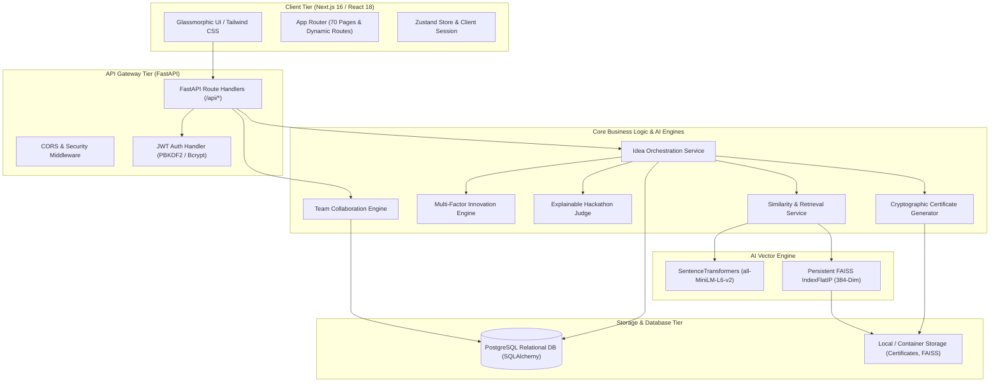
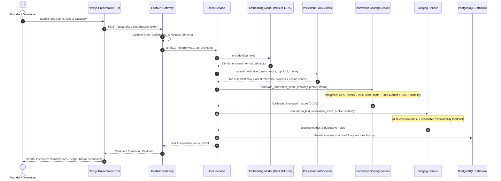
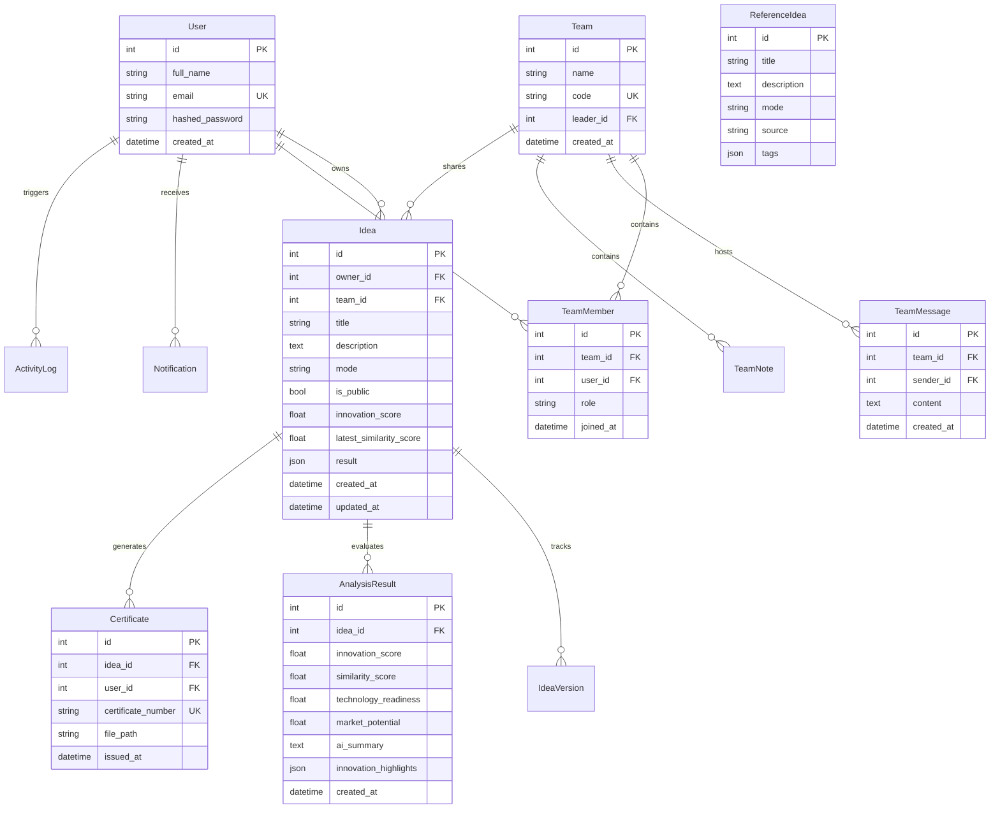

# UPDATED ARCHITECTURE SPECIFICATION

**Project:** AI Idea Authenticity & Innovation Platform  
**Architecture Status:** Production-Ready & Verified  
**Date:** November 1, 2026  

---

## 1. High-Level Architectural Overview

The AI Idea Authenticity & Innovation Platform is structured as a decoupled, multi-tier full-stack system designed for low-latency AI inferencing, scalable relational persistence, and secure multi-tenant collaboration.

---

## 2. End-to-End Analysis Data Flow

When a user submits an idea for authenticity and innovation analysis, the platform processes the request through the following deterministic pipeline:

---

## 3. Database Architecture (SQLAlchemy Authority)

The database schema is managed authoritatively by SQLAlchemy in `backend/database/models.py`.

---

## 4. AI & Vector Engine Architecture

### Model Specifications
- **Model:** `sentence-transformers/all-MiniLM-L6-v2`
- **Inference Runtime:** PyTorch (`USE_TF=0`, `USE_TORCH=1`)
- **Embedding Dimension:** 384 dimensions
- **Normalization:** L2 Euclidean normalization ($\|\vec{v}\|_2 = 1.0$), ensuring inner product equals cosine similarity.

### FAISS Vector Database
- **Index Type:** `faiss.IndexFlatIP` (Exact Inner Product Cosine Search)
- **Index Persistence File:** `backend/storage/faiss/idea_index.faiss` (384 KB)
- **Metadata Persistence File:** `backend/storage/faiss/idea_index_meta.json` (149 KB)
- **Dataset Size:** 260 distinct high-fidelity benchmark ideas spanning 8 core industry verticals.
- **Query Performance:** Pre-loaded in RAM on startup; search latency is sub-15ms.

---

## 5. Security & Authorization Architecture

1. **Object-Level Authorization (IDOR Defense):**
   - Every state-altering or private data retrieval operation resolves via `_owned_idea(idea_id, user_id)` or `_accessible_idea(idea_id, user_id)`.
   - Private ideas are strictly unreachable by non-owners (yielding 404/403).
   - Team-shared ideas require verified membership in `TeamMember`.

2. **Unified JWT Contract:**
   - Dual claims: `sub` (standard) and `userId` (Next.js client compatibility) are embedded in every token.
   - Dual-scheme password hashing: Passlib supports both `pbkdf2_sha256` and `bcrypt` with automatic legacy migration.
   - Production validation: Startup is halted if the default JWT secret is detected when `APP_ENV=production`.

3. **Certificate Security:**
   - Filenames incorporate SHA-256 entropy based on `idea_id`, `owner_id`, and exact registration timestamp, preventing overwrites.
   - Strict canonical path traversal checks prevent directory climbing (`..`, `%2e%2e`).

4. **CORS Hardening:**
   - CORS origin configuration parses explicit allowed domains from environment configurations. Wildcard origins combined with credentials are strictly prohibited.
